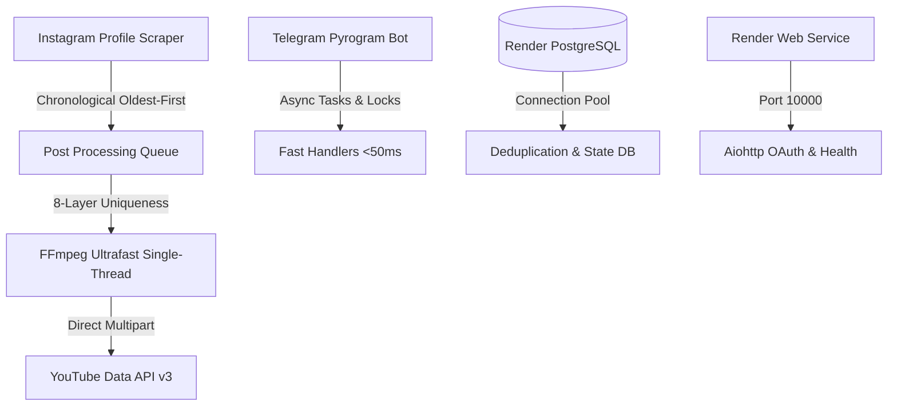

# 🚀 Antigravity 2.0 Project Context & Master Handoff

> **Repository:** `qosimovaumida345-ux/MyAutoReply-x-YoutubeChannelAnalyser`  
> **Target OS:** Windows (Dev) / Linux Docker (Prod on Render)  
> **Bot Name:** CreatorFlow Studio (`@Creator Flow | Ai Bot`)  
> **Web Service:** `https://botclient-d1jn.onrender.com`  
> **Owner Telegram ID:** `6735799833`  
> **Date:** October 2026  

---

## 📌 1. Project Overview & Core Mission
**CreatorFlow Studio** is an all-in-one Telegram Bot + Web App + YouTube automation suite built with **Python 3.11**, **Pyrogram (MTProto)**, **aiohttp**, **PostgreSQL**, and **Google YouTube Data API v3**.

### Primary Capabilities:
1. **AI Auto-Reply & Channel Analytics:** Real-time YouTube comment monitoring, contextual AI replies (Gemini API pool), view/retention analytics.
2. **Instagram ➔ YouTube Shorts Auto-Cloner & Reposter:**
   - Tracks target Instagram profiles (e.g. `@petergriffin.ai`).
   - Scrapes reels without requiring login using mobile Polaris SSR headers.
   - **Chronological Oldest-First Queue:** Syncs from the very first (oldest) post on the account up to the latest post.
   - **8-Layer Anti-Copyright Uniqueness Engine:** Lightweight audio/video modifications (scale 720x1280, 1.02x tempo/PTS, color grade, metadata scrub).
   - **YouTube Daily Upload Quota Handling:** Gracefully catches `uploadLimitExceeded` / `quotaExceeded`, pauses until the next UTC day, and resumes automatically without duplicate uploads.
3. **Monetization & Store Automation:**
   - Humo card invoicing with auto-receipt verification.
   - CapCut Pro subscriptions & VenteBot API integration.
   - 3D Collectible NFTs (Octane render prompts + `.glb` models).
   - Dynamic currency conversion with CBU USD/UZS live rates (+150% margin).
4. **Channel Automation (`@CreatorFlow_Store`):**
   - Posts channel notifications using a Telegram Premium Userbot session (`SESSION_STRING`) for native Telegram custom emoji rendering (`<emoji id="...">`).

---

## 🏛 2. System Architecture & Tech Stack



### Key Modules & Files:
- **`main.py`**: Server initialization, Pyrogram bot startup, aiohttp web server (`PORT=10000`), Google OAuth redirect endpoints, and background daemons.
- **`instagram_cloner.py`**:
  - `scrape_instagram_recent_posts(ig_username, oldest_first=True)`
  - `download_and_8layer_uniqueify(post_url, post_id)` (Render 512MB RAM optimized)
  - `sync_instagram_account_now(tg_user_id, ig_username)`
  - `start_instagram_sync_daemon(app, interval_seconds=1800)`
- **`autopost.py`**: Google OAuth token exchange, YouTube client initialization, and `upload_to_youtube` via direct multipart upload.
- **`mega_features.py`**: UI menus for `/igcloner`, CapCut Pro, vouchers, and store actions.
- **`ytbot.py`**: Core Telegram handlers, inline query menus, analytics, invoices, and settings.
- **`database.py`**: PostgreSQL connection pooling (`ThreadedConnectionPool`), schema migration, and tables:
  - `users`: Registered users, balance, VIP status.
  - `youtube_channels`: Connected channel credentials (`refresh_token`, channel ID, title).
  - `ig_sync_channels`: Tracked Instagram accounts per user.
  - `ig_synced_posts`: Dedup table (`sync_channel_id`, `ig_post_id`, `yt_video_id`, `status`).

---

## ⚙️ 3. Critical Problems Solved & Decisions Made

### A. The Render 512MB OOM Kill & Restart Loop
- **Issue:** On Render's free tier (512MB RAM), FFmpeg was running multi-threaded 1080p encoding. Memory exceeded 400MB, triggering the Linux OOM Killer (`SIGKILL`). The container crashed, rebooted, and repeatedly attempted the same unfinished video (`[1/12] Reel #DaNsooPtBPJ yuklanmoqda...`), freezing `/start`.
- **Fix:**
  - Downscaled resolution to **720x1280 vertical**.
  - Enforced single-thread encoding: `-threads 1 -preset ultrafast -crf 28 -maxrate 1500k -bufsize 2000k`.
  - RAM consumption dropped to **<25 MB**, runtime reduced to **~5 seconds**.
  - Marked `DaNsooPtBPJ` (and PK `3930994355803001801`) as `synced` in PostgreSQL.

### B. Telegram UI Freezing / Unresponsiveness
- **Issue:** `/igcloner sync` handlers were synchronously awaiting the long sync loop inside Pyrogram callbacks, stalling the event loop.
- **Fix:**
  - Offloaded background tasks to `asyncio.create_task`.
  - Added concurrency guard: `is_sync_in_progress(tg_user_id, ig_username)` to prevent redundant sync jobs.
  - Telegram commands now respond instantly (<50ms).

### C. Oldest-First Chronological Ordering
- **Implementation:** Reels are scraped, sorted by `(timestamp, pk)` ascending. The oldest video is uploaded first, progressing forward to modern reels.

---

## 📊 4. Current State & Active Environment

- **Git Branch:** `main` (Latest commit: `ff2c7a2`)
- **Remote:** `https://github.com/qosimovaumida345-ux/MyAutoReply-x-YoutubeChannelAnalyser.git`
- **Render Service:** `botclient` (`https://botclient-d1jn.onrender.com`)
- **Active Target User:** `6735799833`
- **Active YouTube Channel:** ID `6` (`Welf Edits | | YT`), valid Google OAuth refresh token.
- **Current Instagram Sync Status (`petergriffin.ai`):**
  - **12 total posts scraped.**
  - **Video 1 (`DaNsooPtBPJ`):** Marked `synced` (`yt_video_id`: `fv92VrFv0GA`).
  - **Video 2 (`DdmD7mqv8Qb`):** Next in queue.
  - **Videos 3-12:** Pending, awaiting next sync run up to YouTube quota limits.

---

## 🛠 5. Instructions for Antigravity 2.0 / Subagents

When picking up this codebase in Antigravity 2.0:
1. **Always verify dependencies & syntax before committing:**
   ```powershell
   python -m py_compile autopost.py instagram_cloner.py mega_features.py main.py database.py ytbot.py
   ```
2. **Maintain Render 512MB RAM limits:**
   - Never remove `-threads 1` or switch to high CRF/slow presets in FFmpeg.
   - For heavy offloaded jobs, use the external worker architecture (`worker.py` / Cloud Run / GitHub Actions).
3. **Preserve MTProto & Pyrogram asynchronous conventions:**
   - Never block handlers with heavy tasks or long sleeps without `asyncio.create_task`.
4. **Adhere to the Anti-AI-Slop & Vector Icon standard:**
   - Use Lucide SVG or custom verified emoji sequences via `custom_emojis.py` (`ce(...)`), avoiding raw mismatched emojis.
